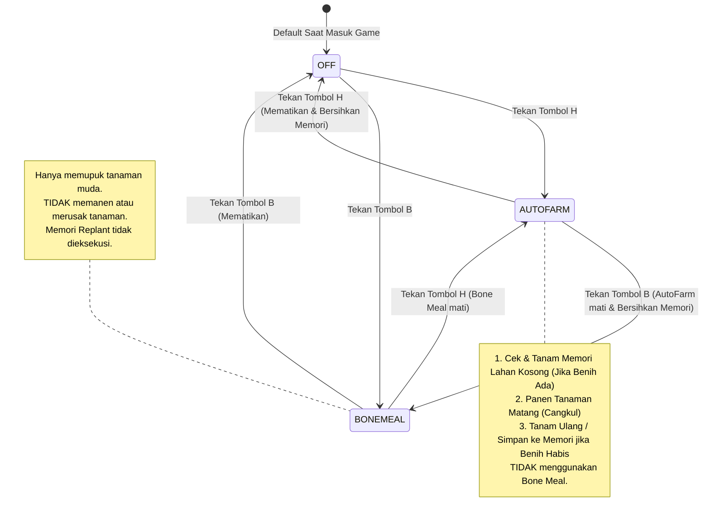

# Implementation Plan: Noe AutoFarm Fabric Mod (Minecraft Java 1.21.11)

> **Catatan Status**: Dokumen perencanaan teknis penambahan fitur **Memori Lahan Kosong & Penanaman Tertunda (Pending Replant Memory)**.
> **Peringatan Eksekusi**: Belum dieksekusi ke kode/build, menunggu konfirmasi pengguna sesuai instruksi (*jangan eksekusi dahulu*).

**Tujuan**: Membangun dan menyempurnakan mod Fabric Minecraft Java **1.21.11** (Loader **0.19.3**) dengan sistem memori pertanian cerdas (**Farm Memory Manager**), penanganan panen saat benih kosong/habis, auto-refill benih dari inventaris utama ke hotbar, fitur AutoFarm & Auto Bone Meal yang bersifat **Mutually Exclusive**, **Proteksi Pasif Anti-Trample Farmland**, aturan **Semantic Versioning (`1.1.0+1.21.11`)**, branding logo kustom [avatarHead3.png](file:///D:/laragon/www/Noe-Mod/avatarHead3.png), serta **output hasil akhir JAR di direktori `D:\laragon\www\Noe-Mod\Hasil\`**.

---

## 1. Aturan Semantic Versioning (SemVer 2.0.0)

Format rilis mod:
$$\text{MAJOR}.\text{MINOR}.\text{PATCH}+\text{MINECRAFT\_VERSION}$$

- Versi Sebelumnya: `1.0.0+1.21.11`
- **Versi Target Saat Ini**: `1.1.0+1.21.11` (Peningkatan **MINOR** karena penambahan sistem memori penanaman tertunda F-10 yang sepenuhnya *backward-compatible*).

| Bagian | Kriteria Perubahan | Contoh Kasus |
|---|---|---|
| **MAJOR** (`X.0.0`) | Breaking changes arsitektur atau format konfigurasi | Refactoring format config JSON, perubahan signature API publik mod |
| **MINOR** (`1.X.0`) | Penambahan fitur baru yang *backward-compatible* | Sistem Memori Lahan Kosong (F-10), Anti-Trample Farmland, GUI Menu |
| **PATCH** (`1.1.X`) | Perbaikan bug atau optimasi kecil | Penyesuaian cooldown tick, penanganan ghost item, sinkronisasi slot |
| **METADATA** (`+1.21.11`) | Target versi Minecraft Java Edition | Memastikan launcher mengenali versi game secara tepat |

---

## 2. Arsitektur Teknis & State Machine

### 2.1 State Machine Diagram (Mutually Exclusive)


---

### 2.2 Diagram Alur Kerja Tick (Tick Workflow dengan Farm Memory)

```mermaid
graph TD
    subgraph "Fitur Pasif: Proteksi Farmland (Zero Tick Cost)"
        Jump[Pemain Melompat / Mendarat di Farmland] --> MixinCheck{Mixin: FarmlandBlock.onLandedUpon}
        MixinCheck --> IsPlayer{Entitas = Player?}
        IsPlayer -- Ya --> CancelTrample[Batalkan setToDirt -> Farmland Tetap Utuh]
        IsPlayer -- Bukan --> NormalTrample[Proses Normal Vanilla]
    end

    subgraph "Fitur Aktif: Engine AutoFarm dengan Memori Lahan"
        Tick[ClientTickEvents.END_CLIENT_TICK] --> CheckState{Current Mode?}
        CheckState -- Mode OFF --> Exit[Lewati Tick]
        CheckState -- Mode BONEMEAL --> HandleBoneMeal[Eksekusi Cabang Auto Bone Meal] --> Exit
        
        CheckState -- Mode AUTOFARM --> CheckCD{Cooldown <= 0?}
        CheckCD -- Tidak --> DecrCD[Kurangi Cooldown] --> Exit
        CheckCD -- Ya --> CheckMemEnabled{Config: enableFarmMemory?}
        
        %% Cabang Prioritas 1: Antrean Memori Lahan Kosong
        CheckMemEnabled -- Ya --> CheckPendingMem{Ada Titik Lahan Kosong dalam Jangkauan?}
        CheckPendingMem -- Ya --> CheckSeedAvail{Pemain Punya Benih yang Cocok?}
        
        CheckSeedAvail -- Ya --> EnsureHotbar[Refill Benih ke Hotbar jika perlu]
        EnsureHotbar --> PlantMemory[Tanam Benih ke Lahan Kosong & Hapus dari Memori]
        PlantMemory --> SetCD1[Set Cooldown: tickDelay] --> Exit
        
        %% Cabang Prioritas 2: Pemanenan Normal Tanaman Matang
        CheckPendingMem -- Tidak / Benih Belum Ada --> ScanMature[Pindai Tanaman Matang di Radius]
        CheckMemEnabled -- Tidak --> ScanMature
        
        ScanMature --> HasMature{Ada Tanaman Matang?}
        HasMature -- Tidak --> CleanMem[Validasi & Bersihkan Memori Kadaluarsa] --> Exit
        HasMature -- Ya --> ToolSwap[Ganti ke Cangkul & Hancurkan Blok]
        ToolSwap --> CheckReplantDirect{Punya Benih Langsung di Hotbar/Inv?}
        
        CheckReplantDirect -- Ya --> ReplantDirect[Tanam Langsung Kembali]
        CheckReplantDirect -- Tidak --> SaveToMem[Simpan Koordinat & Jenis Benih ke FarmMemoryManager]
        
        ReplantDirect --> SetCD2[Set Cooldown: tickDelay] --> Exit
        SaveToMem --> SetCD2 --> Exit
    end
```


---

### 2.3 Struktur Direktori Proyek Target
```text
D:\laragon\www\Noe-Mod\
│
├── Hasil/                                <-- Direktori Khusus Output Hasil Akhir
│   └── noemod-1.1.0+1.21.11.jar          <-- File Mod JAR Siap Pakai Versi 1.1.0
│
├── gradle/
│   └── wrapper/
│       ├── gradle-wrapper.jar
│       └── gradle-wrapper.properties
├── gradlew
├── gradlew.bat
├── build.gradle
├── settings.gradle
├── gradle.properties
│
├── PRD.md                                <-- PRD Versi 1.1.0+1.21.11
├── PLANNING.md                           <-- Dokumen Perencanaan Teknis
├── avatarHead3.png                       <-- Logo Asli
│
└── src/
    └── main/
        ├── java/
        │   └── com/
        │       └── noemod/
        │           ├── NoeMod.java               <-- Mod Initializer utama
        │           ├── NoeModClient.java         <-- Client Initializer, Keybinds, & Reset Memori
        │           ├── config/
        │           │   ├── AutoFarmConfig.java   <-- Konfigurasi (+ enableFarmMemory)
        │           │   └── ConfigManager.java    <-- Penyimpanan format JSON
        │           ├── gui/
        │           │   ├── NoeModConfigScreen.java     <-- GUI Settings (+ Toggle Memori Lahan)
        │           │   └── NoeModMenuIntegration.java  <-- Entrypoint ModMenu
        │           ├── autofarm/
        │           │   ├── FarmingMode.java            <-- Enum: OFF, AUTOFARM, BONEMEAL
        │           │   ├── AutoFarmEngine.java         <-- Integrasi Replant Memory & Harvesting
        │           │   ├── FarmMemoryManager.java      <-- [BARU] Pengelola Memori Lahan Kosong & Antrean
        │           │   ├── CropHelper.java             <-- Validasi mature, fertilizable, soil check
        │           │   ├── ToolHelper.java             <-- Deteksi Hoe & algoritma pemilihan cangkul
        │           │   └── InventoryHelper.java        <-- Hotbar swap & Smart Inventory Refill
        │           ├── mixin/
        │           │   └── FarmlandBlockMixin.java     <-- Proteksi pasif anti-trample
        │           └── util/
        │               └── MessageHelper.java          <-- Notifikasi Actionbar dengan warna
        │
        └── resources/
            ├── fabric.mod.json                   <-- Metadata Fabric (v1.1.0+1.21.11)
            ├── noemod.mixins.json                <-- Konfigurasi Mixin Fabric
            └── assets/
                └── noemod/
                    └── icon.png                  <-- avatarHead3.png
```

---

## 3. Rincian Desain Modul (Module Breakdown)

### 3.1 Modul Baru: `FarmMemoryManager.java` (Pengelola Memori Lahan Kosong)
- **Tujuan**: Menyimpan lokasi-lokasi lahan bekas panen yang belum berhasil ditanami kembali karena benih kosong/habis.
- **Struktur Data Internal**:
  ```java
  public class FarmMemoryManager {
      public record PendingReplant(
          BlockPos cropPos,       // Posisi blok tanaman (udara di atas farmland)
          Item requiredSeed,      // Jenis benih yang dibutuhkan (cth: WHEAT_SEEDS)
          long addedGameTime      // Waktu penambahan untuk expiry pruning
      ) {}

      // Menggunakan Map untuk mencegah duplikasi koordinat yang sama
      private static final Map<BlockPos, PendingReplant> pendingReplants = new ConcurrentHashMap<>();
      private static final long MAX_RETENTION_TICKS = 6000L; // 5 menit
      private static final double MAX_DISTANCE_SQ = 48.0 * 48.0;
  }
  ```
- **Metode Utama**:
  1. `recordEmptyFarmland(BlockPos pos, Item expectedSeed, long gameTime)`:
     - Mendaftarkan lahan kosong setelah aksi `attackBlock()` jika tidak ada benih yang bisa ditanam saat itu.
  2. `findBestPendingTarget(ClientPlayerEntity player, World world, double reachSq)`:
     - Mencari target dalam jarak jangkau (`distSq <= reachSq`) di mana pemain memiliki benih yang cocok di inventaris/hotbar.
     - Memvalidasi bahwa blok di koordinat masih berupa `Air` dan blok di bawahnya adalah `Farmland` atau `Soul Sand`. Jika sudah bukan, hapus otomatis (*lazy invalidation*).
  3. `removeTarget(BlockPos pos)`:
     - Menghapus entri setelah penanaman berhasil dilakukan.
  4. `pruneInvalidAndExpired(World world, ClientPlayerEntity player)`:
     - Dijalankan secara periodik (misal setiap 100 tick) untuk menghapus titik yang kadaluarsa (> 5 menit), di luar radius 48 blok, atau sudah terisi tanaman lain.
  5. `clear()`:
     - Membersihkan seluruh daftar antrean saat AutoFarm dimatikan (`FarmingMode.OFF`) atau saat berpindah world/server.

### 3.2 Penyempurnaan `InventoryHelper.java` (Smart Inventory Refill)
- **Kebutuhan**:
  - Saat panen, benih yang jatuh dan terambil pemain sering masuk ke inventaris utama (slot 9-35), bukan hotbar (slot 0-8).
  - Jika mod hanya mengecek hotbar, penanaman akan gagal meskipun pemain mengantongi ratusan benih di tasnya.
- **Metode Tambahan**:
  ```java
  // Mencari slot item di seluruh inventaris (hotbar 0-8 maupun tas 9-35)
  public static int findItemSlotInEntireInventory(PlayerInventory inventory, Item item);

  // Mengisi ulang benih ke hotbar secara otomatis
  public static int ensureSeedInHotbar(MinecraftClient client, Item seedItem);
  ```
  - Jika benih sudah ada di hotbar: kembalikan indeks slot hotbar tersebut.
  - Jika hanya ada di inventaris utama (slot 9-35): mod menukar (*swap*) item tersebut ke slot kosong di hotbar atau slot aktif pemain menggunakan interaksi packet `clickSlot` / `pickItem` client.

### 3.3 Penyesuaian `AutoFarmEngine.java` (Prioritas Replant vs Harvest)
- **Urutan Eksekusi pada Tick AutoFarm**:
  1. **Langkah 1 (Pending Replant Memory)**:
     - Jika `AutoFarmConfig.enableFarmMemory == true`:
     - Panggil `FarmMemoryManager.findBestPendingTarget(player, world, reachSq)`.
     - Jika ditemukan target lahan kosong:
       - Pastikan benih ada di hotbar melalui `ensureSeedInHotbar()`.
       - Lakukan klik kanan penanaman (`interactBlock` arah `Direction.UP`).
       - Hapus posisi dari memori via `FarmMemoryManager.removeTarget(targetPos)`.
       - Berikan cooldown `AutoFarmConfig.tickDelay` dan selesaikan tick saat itu.
  2. **Langkah 2 (Pemanenan Tanaman Matang Normal)**:
     - Jika tidak ada target pending replant (atau benih untuk target tersebut belum ada):
     - Pindai tanaman matang terdekat (`CropHelper.isHarvestableCrop`).
     - Jika ada tanaman matang:
       - Hancurkan dengan cangkul terbaik (`attackBlock`).
       - Periksa benih yang cocok:
         - Jika ada benih (di hotbar/tas): langsung tanam kembali (`interactBlock`).
         - Jika TIDAK ada benih sama sekali: panggil `FarmMemoryManager.recordEmptyFarmland(targetPos, matchingSeed, world.getTime())`.
       - Berikan cooldown `AutoFarmConfig.tickDelay`.

### 3.4 Penyesuaian Konfigurasi & GUI (`AutoFarmConfig.java` & `NoeModConfigScreen.java`)
- **Penambahan Parameter**:
  - `public static boolean enableFarmMemory = true;`
- **Integrasi GUI**:
  - Menambahkan tombol toggle visual: `"Memori Lahan: AKTIF"` / `"Memori Lahan: NONAKTIF"` di `NoeModConfigScreen.java`.
  - Nilai tersimpan ke file JSON `.minecraft/config/noemod.json`.

---

## 4. Tahapan Rencana Kerja (Task Breakdown)

> [!NOTE]
> Semua tahapan berikut berada dalam status **Menunggu Persetujuan Pengguna (Pending Approval)** dan **belum dieksekusi** ke file sumber kode.

| No | Tahap / Subtask | Deskripsi Teknis | Status |
|---|---|---|---|
| **Fase 1 - 8** | **Pondasi Awal Noe-Mod** | Loom MC 1.21.11, Fabric Loader 0.19.3, Assets/Icon, FarmlandBlockMixin, Mutually Exclusive Keybinds, Crop/Tool Helpers, AutoFarm/BoneMeal Pipeline, GUI Config Screen. | Selesai (v1.0.0) |
| **9.1** | **Arsitektur `FarmMemoryManager.java`** | Buat kelas pengelola antrean memori koordinat lahan kosong, penyimpanan tipe benih yang dibutuhkan, metode pencarian target terdekat, validasi lahan, pembersihan kadaluarsa, dan metode `clear()`. | Selesai |
| **9.2** | **Smart Seed Refill di `InventoryHelper.java`** | Tambahkan logika pemindaian inventaris penuh (slot 0-35) dan pemindahan otomatis benih dari inventaris tas (slot 9-35) ke hotbar (slot 0-8) saat benih di hotbar habis. | Selesai |
| **9.3** | **Integrasi Engine di `AutoFarmEngine.java`** | Integrasikan cabang prioritas pending replant sebelum harvest. Catat lahan ke memori jika panen berhasil namun ketiadaan benih. Tangani pembersihan memori saat mode `OFF`. | Selesai |
| **9.4** | **Konfigurasi & GUI Pengaturan** | Tambahkan opsi `enableFarmMemory` ke `AutoFarmConfig.java` dan tambahkan tombol interaktif di `NoeModConfigScreen.java`. | Selesai |
| **9.5** | **Pembaruan SemVer & Metadata Fabric** | Naikkan versi mod ke `1.1.0+1.21.11` di `fabric.mod.json`, `gradle.properties`, `PRD.md`, dan `PLANNING.md`. | Selesai |
| **9.6** | **Kompilasi & Verifikasi Build** | Jalankan `gradlew build`, verifikasi ketiadaan error kompilasi, dan pastikan output JAR baru tersalin ke `D:\laragon\www\Noe-Mod\Hasil\noemod-1.1.0+1.21.11.jar`. | Selesai |

---

## 5. Ringkasan Hasil Deliverable Target

- **File JAR Mod Rilis**: [noemod-1.1.0+1.21.11.jar](file:///D:/laragon/www/Noe-Mod/Hasil/noemod-1.1.0+1.21.11.jar)
- **Target Versi SemVer**: `1.1.0+1.21.11`
- **Lokasi Folder**: `D:\laragon\www\Noe-Mod\Hasil\`
- **Fitur Baru Tambahan**:
  1. **Pending Replant Memory Queue**: Lahan kosong bekas panen saat benih 0 atau habis tercatat dengan aman di memori.
  2. **Smart Inventory Refill**: Benih yang berada di tas inventaris utama otomatis digunakan ke hotbar tanpa perlu dipindah manual oleh pemain.
  3. **Auto-Filling Lahan Kosong**: Begitu benih diperoleh dari drop panen berikutnya, lahan kosong dalam memori yang terdekat langsung ditanami kembali sesuai jenis tanaman aslinya.
  4. **Toggle Konfigurasi**: Pemain dapat menyalakan/mematikan fitur memori lahan melalui file JSON maupun layar GUI ModMenu.
